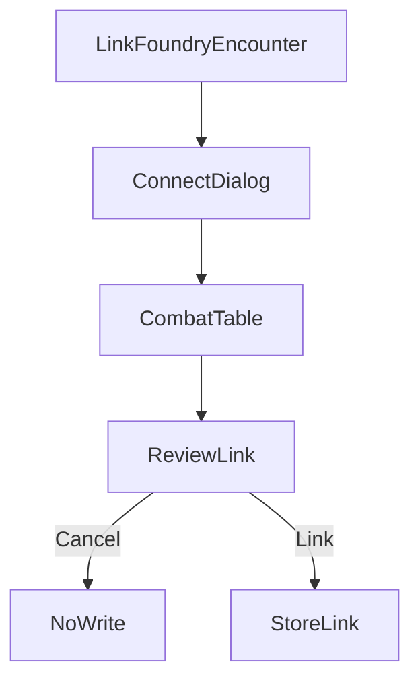

# Link a Wanderer's Guide encounter to a Foundry combat

**Status: design only.** No button, no stored link, and no combat sync exist for this flow.

A Wanderer's Guide encounter is one row (`EncounterSchema` in `src/schemas/content.ts`: `id`, `campaign_id`, `name`, `combatants.list`). A Foundry encounter is one combat document in a world. This document links those two records. It does not copy combatants, initiative, HP, or turn order.

The character import in `docs/foundry-to-wgui.md` is a different flow. That flow creates or updates a character. This flow only records that one campaign encounter and one Foundry combat are the same fight.

## Where this is built

| Piece | Repo | What it does |
| --- | --- | --- |
| Link action on the open campaign encounter, review, and the write onto the encounter row | This repo, `WandersGuideUI` | The GM connects, picks one Foundry combat, and confirms. |
| Connection code, read-only combat list, read-only combat identity, and the flag on that combat | `foundry-wanderersguide-import` | Same client-scoped connection code as `docs/foundry-to-wgui.md`. The module does not create or edit a Wanderer's Guide encounter. |

The forward character import (`scripts/coverage.js`, `scripts/importer.js`, `scripts/dialog.js`) is not part of this link.

Nothing is fetched until the GM connects. Cancel writes nothing. Link is the only action that stores the pair.

## Who can link

The control sits on the open campaign encounter, for the game master only. The game master is `campaign.user_id` equal to the signed-in auth id (`sameUserId` in `Phase1Workspace`). A player does not see it.

The encounter must already belong to this campaign (`encounter.campaign_id`). Linking does not create an encounter and does not change `combatants.list`.

## Connect

Reuse the connect dialog from `docs/foundry-to-wgui.md`: Foundry origin the browser can reach (`http://localhost:30000` for a local world) and the connection code from the module’s client-scoped setting.

WGUI does not ask for the Foundry admin password and does not store the code on the server. If the origin does not answer, or the code is rejected, the dialog shows that error and stops. There is no file-paste fallback.

The module’s list and combat read for this flow are read-only and gated by that same code. Exact URLs and headers are a module implementation detail. This design names them only as **list combats** and **one combat identity**.

## List

The table is one row per Foundry combat in that world: checkbox (single select), combat name, scene name when Foundry has one, Foundry combat id, party-character count, enemy count, round if the combat has started, and whether a Wanderer's Guide encounter in this campaign already stores that combat id plus world identity.

An empty world is an empty table, not an error. The GM selects one row. **Link** stays disabled until one row is selected and the counts match (below). Cancel closes the dialog.

### Counts must match

Compare the open Wanderer's Guide encounter with the selected Foundry combat before Link is enabled.

- Party characters: Wanderer's Guide combatants that are characters, against Foundry combatants whose actor type is `character`.
- Enemies: the other combatants on each side (creatures and hazards). A hazard counts on both sides or on neither. It is not dropped on one side only.

Link stays disabled while either count differs. The row shows both numbers. This check does not add or remove combatants.

`amba-bridge` publish builds the Foundry combat from creature and trap tokens only. Player characters are added when the GM starts that encounter (`startEncounter` in `foundry/amba-bridge/scripts/encounter.mjs`). A combat that was published and not started can match the enemy count and still fail the party-character count. That is a mismatch, not a reason to skip the check.

### AMBA publish shortcut

When AMBA published the fight, the Foundry combat is already tagged. Publish and Start encounter both store the AMBA container id on `flags["amba-bridge"].encounterId` (`syncEncounterCombats` in `foundry/amba-bridge/scripts/ambaPublisher/publish.mjs`, `getOrCreateCombat` in `encounter.mjs`). That value is the AMBA container id, not the Wanderer's Guide encounter id.

The same container id is written onto the Wanderer's Guide encounter only when Export to Wanderer's Guide stored challenge tables: `meta_data.amba.challenges[].source.containerId` (`extractPf2eChallengeTablesFromEncounter` in AdventureMakerByAct). An export with no challenge tables does not leave a container id on the row. There is no other stored pointer from the Wanderer's Guide encounter id to that Foundry combat (`mapFoundryCombatToWguiEncounter` in `src/shared/vttPublish/wguiPairing.ts` only echoes an id the caller already has).

If one listed combat’s `flags["amba-bridge"].encounterId` equals a `source.containerId` on this encounter’s `meta_data.amba.challenges`, preselect that row. The GM still confirms. Counts still have to match. No match, or more than one match, leaves the table with nothing selected.

## Review

Before any write, show the Wanderer's Guide encounter name and id, the Foundry combat name and id, the world identity that will be stored, and the party-character and enemy counts on each side. Link stays disabled when those counts differ.

If either side already has a different partner, say so. Confirming replaces that stored partner. It does not merge the two fights and does not delete the old Foundry combat or the old Wanderer's Guide encounter.

Cancel writes nothing.

## What is stored

On the Wanderer's Guide encounter, add a declared `meta_data` field when this is implemented (the object is passthrough today; do not leave the link as an undeclared key):

- Foundry world identity
- Foundry combat id
- Foundry combat name, as it was at link time
- Foundry origin the GM connected to

On the Foundry combat, the module stores the reverse pointer on the module flag (`foundry-wanderersguide-import`): Wanderer's Guide encounter id, campaign id, and the Wanderer's Guide host. That flag is how a later session recognizes the pair from inside the world. The module writes that flag only after WGUI has confirmed Link.

One Wanderer's Guide encounter links to one Foundry combat. One Foundry combat links to one Wanderer's Guide encounter. A second link on either side replaces the previous pair.

A failed write on either side leaves the previous link in place. If the Wanderer's Guide row saves and the Foundry flag does not, the dialog reports that the link is incomplete and does not claim the pair is connected.

## Report

After a completed link, the campaign encounter status line names the Foundry combat. After a failure, it names the failure. The stored ids stay on the encounter so a later session can see what was linked.

Unlink, from the same GM control, clears the Wanderer's Guide field and asks the module to clear the combat flag. Cancel leaves both in place.

## Still not specified

Combatants, initiative, HP, conditions, round, and turn are not copied in either direction. Linking two encounters does not add a creature, does not roll initiative, and does not push `combatants.list` onto the Foundry combat.

How a later sync would match a Wanderer's Guide combatant to a Foundry combatant is out of scope. Character identity from `docs/foundry-to-wgui.md` (Foundry actor id plus world identity) is the likely key for PCs. It is not applied here.

Exact Foundry routes stay a module detail, described only as “list combats” and “one combat identity, gated by the connection code.”
