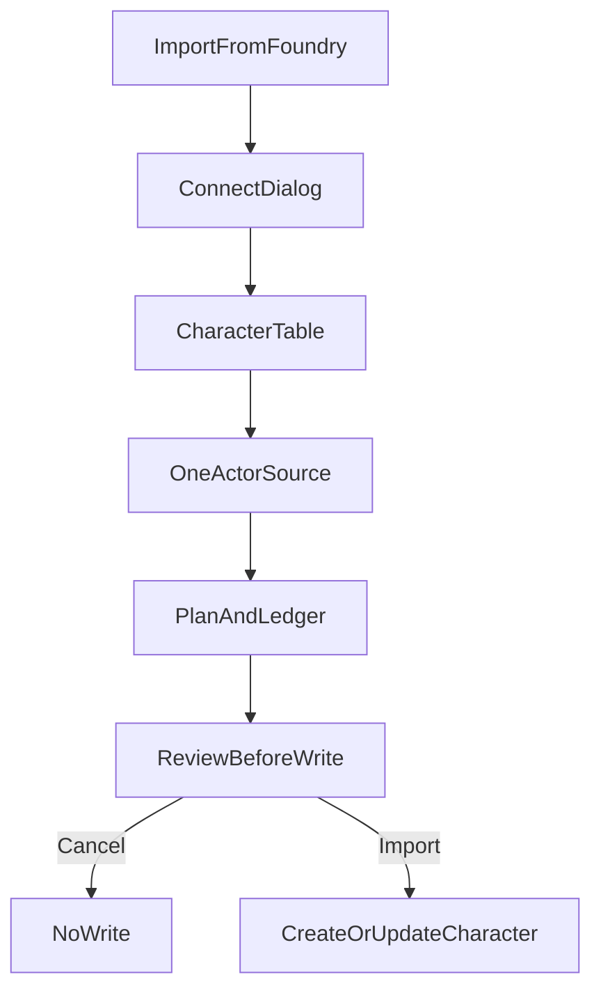

# Import from Foundry (WGUI)

**Status: single-PC import in the character upload menu.** Campaign import is not built. This repo does not serve the Foundry read. Tests mock `fetch` and do not call a world.

The user starts in Wanderer's Guide, from the character upload menu. A Foundry world is the source. The flow imports one player character: connect, pick one actor, review the plan, and write only after confirm. Campaign import is out of this flow. The new or updated character is not given a `campaign_id`.

## Where this is built

Two products. They do not share a button.

| Piece | Repo | What it does |
| --- | --- | --- |
| Button, connect dialog, character table, plan, review, character create/update, status line | This repo, `WandersGuideUI` | The user-facing import. The button is in `src/pages/phase1/Phase1Workspace.tsx`, in the character upload menu that already has Import from JSON, Pathbuilder, GUIDECHAR, and wanderersguide.app. |
| Connection code setting, read-only list, read-only actor source | `foundry-wanderersguide-import` | Answers the browser. Does not write a Wanderer's Guide character. |

The other direction stays the rulebook and is not rewritten here. Foundry already pulls a Wanderer's Guide export through `scripts/coverage.js`, `scripts/importer.js`, and `scripts/dialog.js`. This design classifies each actor path with that ledger, reversed onto Wanderer's Guide content. It does not call those scripts.

Exact Foundry URLs and headers are an implementation detail for the module. This design names the two reads only as **list** and **one actor source**, both gated by the connection code.

Nothing is fetched until the user connects. Cancel on review writes nothing for that PC. Import is the only action that creates or updates.

## Button

In the character upload menu, add **Import from Foundry**. It opens a dialog. The menu is the one in `Phase1Workspace.tsx` (Import from JSON, Import from Pathbuilder, Import from GUIDECHAR, Import from wanderersguide.app).

## Connect

The dialog asks for:

- The Foundry origin the browser can reach. For a local world, `http://localhost:30000`.
- A connection code.

The code is created in this module’s Foundry settings, client scope. Same privacy rule as the Wanderer's Guide API key in `docs/PLAN.md` section 2.2 of `foundry-wanderersguide-import`: client scope, not written into chat, flags, or journals, and not logged. WGUI does not ask for the Foundry admin password. WGUI does not store the code on the server.

The module answers a read-only list and a read-only actor read. If the origin does not answer, or the code is rejected, the dialog shows that error and stops. There is no file-paste fallback.

## List

Same columns as `scripts/dialog.js`: one selector, name, level, ancestry, class, Foundry actor id, and whether a Wanderer's Guide character already stores that actor id plus world identity.

Only character actors. An empty list is an empty table, not an error. The selector is single-choice. **Import** is disabled until one row is selected. Cancel closes the dialog and writes nothing.

There is no campaign tab and no “import every PC in this campaign” action.

## Fetch

WGUI requests that one actor’s source: actor fields, embedded items, and `flags.pf2e.rulesSelections`. A failed read is shown in the dialog. Nothing is written.

The module does not send other users’ secret notes. Biography and GM notes are omitted from the payload.

## Plan, no write yet

Each actor source path gets one status from the forward ledger (`scripts/coverage.js` lines 1–8):

| Status | Meaning |
| --- | --- |
| mapped | Written onto the Wanderer's Guide character: identity, level, a matched content link, or an explicit selection. |
| included | Already represented by another mapped row, so no second copy. |
| unresolved | A choice or a content match that is not exactly one legal Wanderer's Guide option. The Wanderer's Guide builder will ask. The importer does not pick the first option, does not infer a class feature from a derived stat, and does not invent an `operation_data` selection. |
| leftover-preserved | Not interpreted. The raw value is copied verbatim onto the character as `foundryLeftovers`, the reverse of `flags["foundry-wanderersguide-import"].wgLeftovers`. |
| dropped | Omitted, with a reason (document metadata, a stat Wanderer's Guide recomputes, a duplicate item). Unexplained drops are a failed plan. |

Match order is the forward order reversed onto Wanderer's Guide content: slug, then an unambiguous name. Several Wanderer's Guide records for one name stay unresolved.

A world item with no compendium uuid is recorded as explicit homebrew only when the actor item is actually a custom item. A standard miss is unresolved, matching “no unambiguous compendium match; left unresolved (no homebrew copy created)” in `scripts/importer.js`.

## Review

Before any character write, show the five counts, the unresolved list (owner, reason), and the leftover-preserved paths.

Cancel writes nothing for that PC. Import is the only action that creates or updates.

## Write

A new Wanderer's Guide character is created only after Import.

Re-import finds the character that already stores this Foundry actor id and world identity and updates that character. Current HP and other session values that the forward import preserves are preserved on re-import when the Wanderer's Guide character already has them, same idea as the README’s re-import note in `foundry-wanderersguide-import`.

A failed write leaves the previous character in place.

## Report

After the run, the same status line the Pathbuilder import uses (`setJoinStatus` in `Phase1Workspace`) names the character or the failure.

The full ledger stays on the character with the leftovers so a later session can see what was not applied.

## Still not specified

PF2e rule elements are not mapped onto Wanderer's Guide operation keys in this document. A path with no evidenced Wanderer's Guide target is unresolved or leftover-preserved, never a guessed operation.

Class support stays experimental, as in `docs/CLASS_COVERAGE.md` in the Foundry module.

The Foundry read route’s URL and headers are described only as “list” and “one actor source, gated by the connection code.” Exact paths are an implementation detail for the module, not part of this design.
