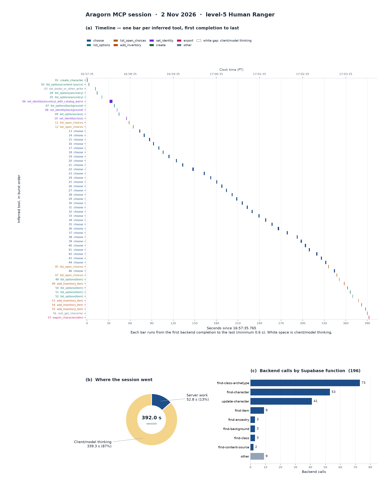

# MCP session performance: Aragorn (2 Nov 2026)

An LLM client built Aragorn, a level-5 Human Ranger (Postgres character id 134), through the wgui MCP tools. The notes below reconstruct that session from gateway logs. The chart is generated from the tool table; regenerate it with `python3 docs/perf/aragorn_session_chart.py` (matplotlib and pandas are not project dependencies).

The timeline draws one bar per inferred tool, from its first backend completion to its last, in seconds since 16:57:35.765. A bar is at least 0.6 s wide. White space between bars is client and model thinking. The donut is that same split for the whole session. The bar chart counts backend calls by Supabase function: `namexN` in the source column means N calls, and the chart shows the top 8 plus an other bar.

Per-tool rows: [aragorn-mcp-session-2026-11-02-tools.csv](aragorn-mcp-session-2026-11-02-tools.csv).

## Summary

The session ran from 4:57:35.766 PM to 5:04:07.789 PM PT on Nov 2, 2026, for a total of 392.0 s (6 min 32 s). The client made 57 inferred MCP tool calls, which produced 196 backend Supabase calls. All 196 returned HTTP 200, with no errors and no retries.

## Where the data came from (read-only)

- The source is the Supabase Kong gateway container's access log on vps-ahhh (wanderers-guide-kong-1). It records completion time, path and status, but not request duration.
- The wgui-mcp PM2 error log has per-request durations, but no timestamps, tool names or session ids, so those durations could not be tied to this session.
- Postgres has no table of MCP tool calls. The character row anchored the start: created_at was 4:57:35.744, and Kong logged the create-character completion 21.5 ms later.
- Client IP, MCP session id and client user-agent are not logged.
- MCP tool names were reconstructed from the backend calls: completions were grouped into bursts split at gaps over 1.5 s, and each burst was mapped to the wgui-mcp tool implementation it matches. With a 1.0 s threshold there are 59 bursts instead of 57. Treat the counts as approximate.

## Backend calls by function

find-class-archetype 73, find-character 53, update-character 41, find-item 9, find-ancestry 3, find-class 3, find-background 3, find-content-source 2. One call each: create-character, find-archetype, find-spell, find-language, find-versatile-heritage, find-trait, find-ability-block, wgui-export-character-slim, and a REST GET of /rest/v1/character.

## Inferred MCP tools

choose 33, list_open_choices 4, list_options(item) 4, add_inventory_item 4, list_options(ancestry) 2. One each: create_character, list_options(content-source), list_options(background), list_options(class), set_identity(ancestry) (which includes a 13-call catalog warm-up taking 3.9 s), set_identity(background), set_identity(class), a set_books-style write, rest_get_character, and export_character(slim).

## Timing

- Server work per tool, measured from first to last backend completion within a burst (n=54 multi-call tools): min 21 ms, median 1.24 s, p95 1.71 s, max 3.92 s, total 52.8 s.
- choose alone (n=33): min 1.07 s, median 1.36 s, p95 1.72 s, max 1.87 s, total 45.8 s.
- Gaps between tools, a proxy for model/client thinking time (n=56): min 2.18 s, median 5.68 s, p95 11.46 s, max 13.82 s, total 339.3 s, which is 87% of the session.
- Caveat: the burst windows don't include the first call's own processing time, and the duration of single-call tools is unknown.

## Client efficiency

- Overall the client was efficient. It followed a clean path: create, books, ancestry, background, class, open choices, picks, gear, export. It never backtracked and never had a pick rejected. It listed open choices only 4 times across 33 picks.
- About 4 of the 57 calls were redundant, costing roughly 18 s:
  - It listed ancestries twice in a row (bursts 4 and 5).
  - It called list_open_choices twice back to back with identical 5821-byte results (bursts 11 and 12).
  - It made repeated item searches, two of which returned identical results (bursts 50 and 51).
  - It did a REST character read right before the export, which already returns the character (burst 56).
- The real cost is the tool design. choose accepts only one selection, so the level-5 build needed 33 model turns, at about 5.7 s of thinking plus about 1.4 s of server time each, or roughly 4 minutes in total. Each choose call also refetches the class/archetype catalog twice and the character once, which adds up to 99 backend calls.

## Recommendations

- Add a batch choose that accepts several (selection key, option id) pairs in one call and runs the character operations once. Estimate: 5 to 8 calls instead of 33, and well under 2 minutes end to end.
- Cache the find-class-archetype catalog per session inside wgui-mcp.
- Make export return the full character so a separate read isn't needed. Give the item search better ranking or exact-name matching.
- Add structured, timestamped wgui-mcp logs with the tool name, session id and duration, so future sessions can be measured directly instead of reconstructed.
